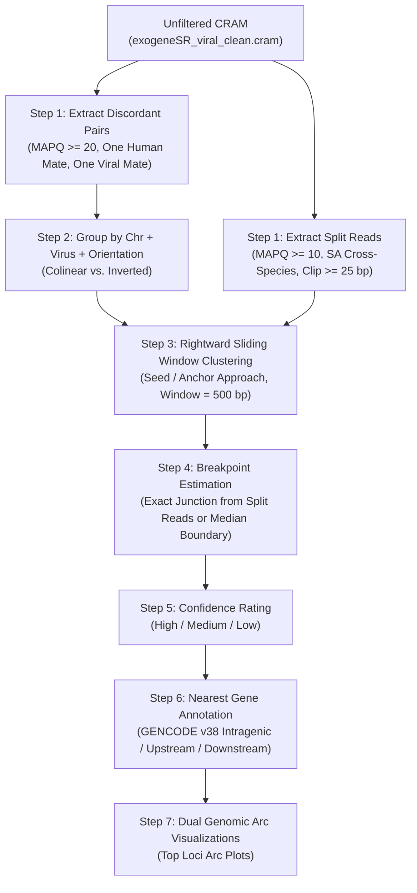

# SSC Dataset Extraction & Alignment Workflow

This tool works modularly to process and align sequencing datasets. It consists of sequential modules whose parameters and execution are fully controlled by the user via the configuration file (`config/ssc_config.yaml`):

0. **Module 0: Human Genome Alignment Module:** Aligns paired-end FASTQ reads directly to the GRCh38 human reference genome using multithreaded BWA-MEM and streams output into sorted, indexed CRAM files.
1. **Module 1: Coverage Calculation Module:** Calculates per-sample human genome sequencing read depth and coverage metrics.
2. **Module 2: Unmapped Extraction Module:** Extracts unmapped human reads from CRAM files to preprocess candidate reads for viral detection.
3. **Module 3: Alignment Module (VIROnator):** Maps candidate reads to the viral database, filters out decoy/RNA sequences, and runs targeted BED filtering.
4. **Module 4: Reporting Module:** Consolidates metrics across output CRAM files (`clean`, `clean_flags`, `raw`), evaluates physical coverage, merges sample metadata, and produces unified 14-column TSV reports.
5. **Module 5: Cohort Stats Summary Module:** Generates cohort-wide statistical snapshots (`cohort_stats_summary.tsv` and `cohort_stats_summary.md`).
6. **Module 6: Distributions & Plots Module:** Produces publication-ready 2-panel 300 DPI TIFF figures and per-virus classification tables.
7. **Module 7: SAM Flag Comparison Module:** Evaluates clean strategy alignment metrics across SAM flag filtering variants.
8. **Module 8: NCBI RefSeq Refinement Module:** Re-aligns candidate reads against complete RefSeq viral genomes using Bowtie2 multimapping (`-k 10`) and a Two-Tier Classification Cascade (`Reference_Unique` vs `Species_Supportive`).
9. **Module 9: Heatmaps Module:** Generates hierarchical clustering heatmaps for viral read counts and viral copy numbers.
10. **Module 10: Discordant Reads & Viral Integration Breakpoints Module:** Identifies chimeric discordant pairs and split reads, performs rightward sliding window clustering (Seed / Anchor approach), estimates single-nucleotide or median breakpoints, assigns call confidence, and annotates nearest host genes.

## Prerequisites
- Snakemake
- Cluster modules: `samtools`, `bwa`, `python`, `jobexec/2.0.1`

## Storage Recommendations: GCS vs. Local Disk

1. **References Directory:** All reference genomes and database files (human, viral, decoy, rna) must be stored directly in the same flat directory on the GCS mount (specifically `/mnt/disks/staff/refs/`) without any nested subfolders.
2. **Access:** Because the batch jobs run on separate ephemeral cloud VM instances, they must be stored on the GCS bucket (`/mnt/disks/staff/refs/`) so the batch execution nodes can access them.

---

## Standalone Utility: FASTA Header Cleaner <small>(rename_fasta_contigs.sh)</small>

When adopting a new vector or plasmid reference dataset, raw FASTA header names often contain special characters (Greek letters like `α`, `β`, `γ`, trademarks `™`, `®`, symbols `+`, `%`, `#`, commas, slashes, and spaces). These special characters cause parsing failures or silent truncation in alignment tools like `bwa mem` and `samtools`.

`scripts/rename_fasta_contigs.sh` is an optional **standalone utility script** to preprocess and sanitize FASTA contig header names. **It is not integrated into the automated Snakemake workflow and should be run manually prior to reference indexing when adding new reference files.**

### How Headers Are Sanitized
1. **Whitespace Replacement:** All spaces, tabs, and non-breaking whitespace characters are immediately converted into underscores `_`.
2. **Greek Transliteration:** Converts Greek characters to English words (`α` $\rightarrow$ `alpha`, `β` $\rightarrow$ `beta`, `λ` $\rightarrow$ `lambda`, `μ` $\rightarrow$ `mu`, `φ` $\rightarrow$ `phi`).
3. **Trademark Removal:** Strips `™`, `®`, `©`, `(TM)`, `(R)`.
4. **Symbol Translation:** Converts mathematical/strand symbols (`(+)` $\rightarrow$ `_plus_`, `(-)` $\rightarrow$ `_minus_`, `+` $\rightarrow$ `_plus_`, `&` $\rightarrow$ `_and_`).
5. **Special Character Conversion:** Any remaining non-alphanumeric character is converted to `_`, and consecutive delimiters are collapsed.
6. **Collision Deduplication:** If two distinct raw headers clean down to the exact same string, numeric suffixes (`_2`, `_3`) are automatically appended to guarantee that **every contig ID is unique**.

7. **NCBI Accession Mode (`-n` / `--ncbi`):** When processing NCBI-formatted FASTA headers (e.g. `>NC_001829 Adeno-associated virus - 4, complete genome.`), passing `--ncbi` strips everything after the first whitespace to keep the accession ID (`NC_001829`) as the contig ID while preserving the original raw header string in `rename_map.tsv`.

### Standalone Execution Syntax

Command options (`-p` / `--prefix` and `-n` / `--ncbi`) **must be placed before the input FASTA file**:

```bash
./scripts/rename_fasta_contigs.sh [OPTIONS] <INPUT_FASTA> <OUTPUT_PREFIX>
```

#### Available Options
* `-p <PREFIX>` / `--prefix <PREFIX>`: Prepends a prefix string to all contig IDs (e.g., `-p "mm39_"` for mouse contigs to prevent collisions with human contigs).
* `-n` / `--ncbi`: Activates NCBI mode, stripping descriptions after the first whitespace to leave accession IDs (e.g., `NC_001829`), while recording full raw headers in `<OUTPUT_PREFIX>.rename_map.tsv`.

#### Usage Commands & Examples

> [!IMPORTANT]
> All sanitized output files (FASTA `.renamed.fa`, rename map `.rename_map.tsv`, contigs list `.renamed.contigs.txt`, and BED file `.renamed.bed`) **must be stored directly in `/mnt/disks/staff/refs/`** so that all downstream pipeline modules can access them properly.

> [!NOTE]
> The `.renamed` extension tag is automatically appended to generated files by default (e.g. `.renamed.fa`, `.renamed.contigs.txt`, `.renamed.bed`). Therefore, the `OUTPUT_PREFIX` command argument should **not** contain the word `"renamed"`, but simply the base reference name (e.g. `HumanViral_Reference_02-07-2022_modified` or `mm39_modified`).

1. **NCBI Viral Reference Database Sanitization**:
   Use `--ncbi` to extract clean accession IDs and avoid overly long contig names coming from full record descriptions:
   ```bash
   scripts/rename_fasta_contigs.sh --ncbi HumanViral_Reference_02-07-2022.fa HumanViral_Reference_02-07-2022_modified
   ```
   **Output Files Generated**:
   - `HumanViral_Reference_02-07-2022_modified.renamed.fa` (Sanitized reference FASTA)
   - `HumanViral_Reference_02-07-2022_modified.rename_map.tsv` (Accession header mapping TSV)
   - `HumanViral_Reference_02-07-2022_modified.renamed.contigs.txt` (Contigs ID list)
   - `HumanViral_Reference_02-07-2022_modified.renamed.bed` (Target BED regions file)

2. **Mouse Genome Reference Sanitization**:
   Use `-p "mm39_"` to prefix contig names and differentiate mouse contigs from human/viral contigs:
   ```bash
   scripts/rename_fasta_contigs.sh -p "mm39_" mm39.fa mm39_modified
   ```

3. **Plasmid Reference Database Sanitization**:
   ```bash
   scripts/rename_fasta_contigs.sh SnapGene.fa SnapGene_modified
   ```

### Generated Output File Formats

Executing the sanitizer script creates five output files in `/mnt/disks/staff/refs/`:

1. **`<OUTPUT_PREFIX>.renamed.fa`** $\rightarrow$ Cleaned FASTA file with sanitized, BWA-compatible headers.
2. **`<OUTPUT_PREFIX>.rename_map.tsv`** $\rightarrow$ Lookup map table containing 2 columns: `final_clean_id` and `original_header`.
3. **`<OUTPUT_PREFIX>.name_collisions.tsv`** $\rightarrow$ Log of name collisions and suffix resolution.
4. **`<OUTPUT_PREFIX>.renamed.contigs.txt`** $\rightarrow$ Clean 1-column list of sanitized contig IDs, stored directly in `/mnt/disks/staff/refs/`.
5. **`<OUTPUT_PREFIX>.renamed.bed`** $\rightarrow$ Clean 3-column BED file (`contig_id\t0\tlength`) covering the full span of each contig in the reference, stored directly in `/mnt/disks/staff/refs/`.

---

### Standalone Utility: Viral Name Shortener <small>(shorten_viral_names.py)</small>

`scripts/shorten_viral_names.py` is a **standalone utility script** that processes a `.renamed_map.tsv` file (created during reference sanitization) and applies rule-based text replacements to abbreviate and clean viral descriptive names for cleaner figure labels in stats and heatmaps.

It supports both local file paths and Google Cloud Storage (`gs://`) URIs.

#### Shortening Rules Applied:
- **Comma Stripping**: Automatically removes all commas (`,`) from headers first.
- **Removals**: Strips genomic descriptors such as ` genomic RNA complete genome strain:`, ` complete genome strain:`, ` genomic RNA complete`, ` genomic DNA partial`, ` genomic DNA`, ` genomic RNA`, ` complete virion genome`, ` virion genome`, ` complete genome`, `sense strand`, and space-dash-space combinations (` - `).
- **Replacements**: Standardizes viral family/species names (e.g. `Torque teno mini virus` $\rightarrow$ `TTV mini`, `Torque teno virus` $\rightarrow$ `TTV`, `Adeno-associated virus` $\rightarrow$ `AAV`, `Simian adenovirus` $\rightarrow$ `Simian Ad`, `Human papillomavirus` / `Human papillomavirus virus` $\rightarrow$ `HPV`, `Human immunodeficiency virus` $\rightarrow$ `HIV`, `Human alphaherpesvirus 1-3` $\rightarrow$ `HHV-1`-`HHV-3`, `Human gammaherpesvirus 4` $\rightarrow$ `EBV`, `Human betaherpesvirus 5` $\rightarrow$ `CMV`, `Human betaherpesvirus 6A/6B/7` $\rightarrow$ `HHV-6A`/`HHV-6B`/`HHV-7`, `Molluscum contagiosum virus` $\rightarrow$ `MCV`, `Porcine endogenous retrovirus` $\rightarrow$ `PERV`).

#### Usage Example:
```bash
# Process map file stored on Google Cloud Storage (automatically saves to gs://<output_bucket>/refs/<map_name>_short.tsv)
python3 scripts/shorten_viral_names.py gs://<output_bucket>/refs/HumanViral_Reference_02-07-2022_modified.renamed_map.tsv
```

---

## Standalone Utility: Taxonomy Index Builder <small>(make_taxonomy_index.py)</small>

`scripts/make_taxonomy_index.py` is a standalone helper script that pre-processes NCBI taxonomy dump files (`nodes.dmp`, `names.dmp`) and accession-to-taxid mapping files (`nucl_gb.accession2taxid`) into a unified, 14-column viral taxonomy lookup index (`viral_reference_taxonomy_index.tsv`).

### Downloading NCBI Taxonomy Source Files
Before executing the script, download the latest NCBI taxonomy dump and accession mapping files:

```bash
mkdir -p /tmp/ncbi_taxdump && cd /tmp/ncbi_taxdump

# Download NCBI taxonomy nodes and names:
curl -sSL -o taxdump.tar.gz https://ftp.ncbi.nlm.nih.gov/pub/taxonomy/taxdump.tar.gz
tar -xzf taxdump.tar.gz nodes.dmp names.dmp

# Download GenBank nucleotide accession-to-taxid mapping:
curl -sSL -o nucl_gb.accession2taxid.gz https://ftp.ncbi.nlm.nih.gov/pub/taxonomy/accession2taxid/nucl_gb.accession2taxid.gz
gunzip nucl_gb.accession2taxid.gz
```

### Execution Command
```bash
python3 scripts/make_taxonomy_index.py \
    --accession-taxid /tmp/ncbi_taxdump/nucl_gb.accession2taxid \
    --nodes /tmp/ncbi_taxdump/nodes.dmp \
    --names /tmp/ncbi_taxdump/names.dmp \
    --output config/db_metadata/viral_reference_taxonomy_index.tsv
```

### Generated Output 14-Column Index Schema (`viral_reference_taxonomy_index.tsv`)
1. `accession` — RefSeq / GenBank accession ID (e.g. `NC_001829`)
2. `accession_version` — Accession version (e.g. `NC_001829.1`)
3. `accession_taxid` — NCBI TaxID assigned to accession
4. `accession_name` — Scientific name assigned to accession
5. `species_taxid` — TaxID of the species rank
6. `species_name` — Species scientific name
7. `genus_taxid` — TaxID of the genus rank
8. `genus_name` — Genus scientific name
9. `family_taxid` — TaxID of the family rank
10. `family_name` — Family scientific name
11. `order_taxid` — TaxID of the order rank
12. `order_name` — Order scientific name
13. `realm_taxid` — TaxID of the realm rank
14. `realm_name` — Realm scientific name

---

## Setup and Execution

### Phase 1: Prepare your Workspace
Before configuring any files, run these steps in your terminal:
1. **Clone the repository:** Clone the `VIROnator` repository to your environment.
2. **Move into the repository folder:**
   ```bash
   cd VIROnator
   ```
3. **Copy your sample list file here:** Copy the file containing the list of sample IDs you want to process directly into this cloned `VIROnator` folder.
   * **What is in this file?** It is a simple text file listing one sample ID per line. The very first line (header) of the file **must** be the word `SAMPLE`. For example:
     ```text
     SAMPLE
     sample_id_1
     sample_id_2
     ```

### Phase 2: Configure your Settings
Open `config/ssc_config.yaml` in a text editor. Configure these settings before running the pipeline:

> [!IMPORTANT]
> This pipeline is designed to run on Google Cloud Platform. Ensure that your GCS parameters (such as `data_bucket`, `output_bucket`, and project details) are properly configured to point to your GCP cloud buckets.

#### 1. Common / Joint Variables
* **`data_dir`**: Shared local mount directory for reading raw input files (`/mnt/disks/lab`).
* **`data_subdir`**: Middle subdirectory path inside `data_dir` (e.g. `"tertiary/SSC_hg38/WGS"`, or `""` for flat datasets).
* **`input_keyword`**: Optional middle keyword following sample ID dot (e.g. `"final"`, `"sorted"`, or `""` for none).
* **`input_suffix`**: Target file extension following keyword (e.g. `"cram"`, `"bam"`).
* **`output_dir`**: Shared local mount directory for output files (`/mnt/disks/staff`).
* **`work_dir`**: Active repository root directory on head node (default `"."`).
* **`data_bucket`**: Source GCS bucket containing raw sequence files.
* **`output_bucket`**: Destination GCS bucket for output data and cluster execution logs.
* **`gcp_account`**: GCP Service Account email address for cluster execution.
* **`pi`**: Principal Investigator initials/tag (e.g. `"MDJ"`).
* **`pau`**: Project Allocation Unit code (e.g. `0`).
* **`task_name`**: Cluster job log identifier prefix tag.
* **`dataset`**: Dataset cohort prefix label (e.g. `"SSC"`).
* **`genome_build`**: Human reference genome assembly build label (e.g. `"hg38"`).
* **`phase`**: Dataset phase identifier (e.g. `"2"`, or `"none"` / `""` for flat datasets).
* **`project`**: Sub-project identifier (e.g. `"base"`, or `"none"` / `""` for flat datasets).
* **`samples_list`**: Name of the sample list text file (first line header must be `SAMPLE`).
* **`ref_dir`**: Directory path where reference genomes and database files are stored (`/mnt/disks/staff/refs`).
* **`scripts_dir`**: Repository folder path containing helper scripts (`/mnt/disks/staff/scripts`).
* **`placeholder_file`**: An empty text file (`test.txt`) used for creating directory structures on GCS object storage.

#### 2. Module Execution Switches & Module-Specific Settings
To execute specific pipeline features and modules, simply turn `"on"` or `"off"` the corresponding master switches in `config/ssc_config.yaml` (e.g. `human_alignment_module: "on"`, `coverage_module: "on"`, `unmapped_extraction: "on"`, `viral_db_alignment: "on"`, `reporting_module: "on"`, `stats_module: "on"`, `distributions_module: "on"`, `flag_comparison_module: "on"`, or `refinement_module: "on"`).

> [!NOTE]
> **Module Parameters**: In addition to the Common / Joint Variables defined above, each active module relies on module-specific parameters configured in `config/ssc_config.yaml` (such as dedicated output directory names, reference genome paths, tool binary locations, and metadata files). All parameters under an enabled module are mandatory for that stage to execute and complete successfully.

#### 3. Compile Job and Resource Configuration Files
Whenever you modify configuration variables or switch any pipeline module on or off in `config/ssc_config.yaml`, you must run Snakemake on the head node while located inside the root `VIROnator` directory in order to compile properly into active job execution scripts. This command reads your current configuration settings and dynamically generates all required cluster `.job` scripts and `.config` resource definitions.

```bash
snakemake --cores 1
```

### Phase 3: Execute the Workflow

#### Module 0: Human Genome Alignment Module (`ssc_human_alignment.job`)
Aligns raw paired-end FASTQ reads directly to the GRCh38 human reference genome using multithreaded BWA-MEM and streams output into coordinate-sorted, indexed CRAM files (`.cram` and `.cram.crai`).

```bash
batchRun -multibatch <SAMPLE_LIST> -config config/batch_jobexec_human_alignment.config -non-spot config/ssc_human_alignment.job -investigator <INVESTIGATOR_TAG> -pau <PAU_CODE>
```
Or directly via `jobexec`:
```bash
jobexec batch config/batch_jobexec_human_alignment.config config/ssc_human_alignment.job <SAMPLE_LIST>
```

#### Module 1: Coverage Calculation Module (`ssc_coverage.job`)

```bash
batchRun -multibatch <SAMPLE_LIST> -config config/batch_jobexec_coverage.config -non-spot config/ssc_coverage.job -investigator <INVESTIGATOR_TAG> -pau <PAU_CODE>
```
Combine all cloud-calculated sample coverage outputs into a master file named as `{dataset}_{genome_build}_master_coverage.tsv` and place it directly into your reference metadata directory at `/mnt/disks/staff/refs/`. Later specify this filename as `sample_metadata_file` in `config/ssc_config.yaml` to run **Module 4 (Reporting Module)** to calculate sample mean read depth and normalized viral copy numbers.

#### Module 2: Unmapped Extraction Module (`ssc_unmapped.job`)
```bash
batchRun -multibatch <SAMPLE_LIST> -config config/batch_jobexec_unmapped.config -non-spot config/ssc_unmapped.job -investigator <INVESTIGATOR_TAG> -pau <PAU_CODE>
```

#### Module 3: Alignment Module (`ssc_alignment.job`)
```bash
batchRun -multibatch <SAMPLE_LIST> -config config/batch_jobexec_vironator.config -non-spot config/ssc_alignment.job -investigator <INVESTIGATOR_TAG> -pau <PAU_CODE>
```

#### Module 4: Reporting Module (`ssc_reporting.job`)

Module 4 consists of **two submodules** that can be independently configured via sub-switches in `config/ssc_config.yaml`:

```yaml
reporting_module: "off"                # Master switch for Module 4 (default: off)

# Submodule 4A: Database Taxonomy Index Builder (run ONCE per database release)
make_taxonomy_index_submodule: "off"    # "on" or "off" (default: off)

# Submodule 4B: Master Sample Report Generator (iterates over sample list)
generate_report_submodule: "off"       # "on" or "off" (default: off)
```

##### 1. Submodule 4A: Taxonomy Index Builder (`make_taxonomy_index_submodule`)
- **Execution Mode**: Local / head node execution (does not require `samples_list`).
- **Command**:
  ```bash
  snakemake --cores 1
  ```
- **Note**: This step generates `HumanViral_Reference_02-07-2022_taxonomy_index.tsv` directly in `/mnt/disks/staff/refs/`. It is created **only once** per reference database release as it indexes all accession IDs for the entire database used.

##### 2. Submodule 4B: Master Sample Report Generator (`generate_report_submodule`)
- **Execution Mode**: Parallel cloud batch execution over sample list.
- **Command**:
  ```bash
  batchRun -multibatch <SAMPLE_LIST> -config config/batch_jobexec_reporting.config -non-spot config/ssc_reporting.job -investigator <INVESTIGATOR_TAG> -pau <PAU_CODE>
  ```
- **Generated Per-Sample File**: `<sample_id>_viral_report.tsv`
- **Combined Master Output File**: Once all parallel cloud batch jobs finish, combine all individual sample reports into one master file named `{dataset}_{genome_build}_master_report.tsv` and place it in `/mnt/disks/staff/refs/` (used as input for Module 5 Stats, Module 6 Distributions, and Module 8 Refinement).

#### Module 5: Cohort Stats Summary Module (`stats_module`)
```bash
snakemake generate_stats --cores 1
```
Module 5 generates basic tabular statistics on the viruses that are found and summary statistics plots. Run this command on the head node after compiling your configuration. Snakemake reads your master report at `/mnt/disks/staff/refs/{dataset}_{genome_build}_master_report.tsv` and deposits summary files directly into `/mnt/disks/staff/{dataset}_{genome_build}_stats/`.
- **Generated Summary Files & Figures**:
  - `/mnt/disks/staff/<stats_out_dirname>/{dataset}_{genome_build}_stats_summary.tsv` (Tab-delimited 9-column cohort statistics snapshot)
  - `/mnt/disks/staff/<stats_out_dirname>/{dataset}_{genome_build}_stats_summary.md` (Markdown-formatted executive summary report)
  - `/mnt/disks/staff/<stats_out_dirname>/{dataset}_{genome_build}_virus_stats_{phase}_{project}_VIRUSES_percentages.tiff` (Horizontal bar plot showing positive sample percentages per virus)
  - `/mnt/disks/staff/<stats_out_dirname>/{dataset}_{genome_build}_virus_stats_{phase}_{project}_VIRUSES_reads.tiff` (Horizontal bar plot showing total assigned reads per virus)
  - `/mnt/disks/staff/<stats_out_dirname>/{dataset}_{genome_build}_virus_stats_{phase}_{project}_VIRUSES_classes.tiff` (Vertical bar plot showing occurrence counts across 4 preliminary classification categories, ordered highest to lowest)
  - `/mnt/disks/staff/<stats_out_dirname>/{dataset}_{genome_build}_virus_stats_{phase}_{project}_reads.tiff` (2-panel dataset-wide overall read count distribution figure)
  - `/mnt/disks/staff/<stats_out_dirname>/{dataset}_{genome_build}_virus_stats_{phase}_{project}_copy_number.tiff` (2-panel dataset-wide overall copy number distribution figure)
  - `/mnt/disks/staff/<stats_out_dirname>/{dataset}_{genome_build}_heatmap_read_counts.tiff` (Publication-quality 300 DPI hierarchical clustering heatmap for viral read counts)
  - `/mnt/disks/staff/<stats_out_dirname>/{dataset}_{genome_build}_heatmap_copy_number.tiff` (Publication-quality 300 DPI hierarchical clustering heatmap for viral copy number values)

#### Module 6: Distributions & Plots Module (`distributions_module`)
```bash
snakemake generate_distributions --cores 1
```
- **Generated Summary Files & Figures**:
  - `<stats_out_dirname>/{dataset}_{genome_build}_virus_stats_{phase}_{project}_VIRUSES.tsv` (Detailed per-virus summary table containing prevalence, sample counts, read counts, mean mapped reads, and preliminary classifications: `sporadic_noise`, `systematic_noise`, `virome`, `infection`).
  - `<stats_out_dirname>/{dataset}_{genome_build}_virus_stats_{phase}_{project}_OVERALL.tsv` (High-level executive dataset summary table reporting total positive samples, cohort size, overall positivity rate, total mapped reads, unique viruses detected, top prevalent virus, mean reads per positive sample, and overall classification).
  - `<plots_out_dirname>/VIRUS_<PHASE>_<PROJECT>_<STRATEGY>_<VIRUS_ACC>_<VIRUS_NAME>.tiff` (2-panel 300 DPI publication TIFF figure per detected virus species).
  - `<plots_out_dirname>/<PHASE>_<PROJECT>_<STRATEGY>_VIRAL_POSITIVITY_RATES.tiff` (Cohort-wide horizontal bar plot showing viral prevalence % across all detected viruses for the entire phase/project).
  - `<plots_out_dirname>/<PHASE>_<PROJECT>_<STRATEGY>_OVERALL_SUMMARY.tiff` (Executive 2-panel overall dataset summary figure for the entire phase/project).


#### Module 7: SAM Flag Comparison Module (`ssc_flag_comparison.job`)
```bash
batchRun -multibatch <SAMPLE_LIST> -config config/batch_jobexec_flag_comparison.config -non-spot config/ssc_flag_comparison.job -investigator <INVESTIGATOR_TAG> -pau <PAU_CODE>
```

> [!NOTE]
> **`clean_flags` Strategy Rationale:**
> The `clean_flags` strategy mitigates the overly restrictive read reduction applied by the `f2` (bitwise flag 2 / proper pair) filter in the alternative "no-flag" option. Relying strictly on proper pair alignment statistics can inadvertently discard valid candidate reads, particularly when alignment statistics or pairing metrics are unaligned or not entirely solid. Retaining reads via `clean_flags` ensures a more comprehensive and robust viral read capture.

#### Module 8: NCBI RefSeq Refinement Module (`ssc_refinement.job`)
```bash
# 1. Build taxonomy index TSV:
snakemake config/db_metadata/viral_reference_taxonomy_index.tsv --cores 1

# 2. Download RefSeq complete genomes & build date-stamped Bowtie2 combined reference:
snakemake config/ncbi_download.completed --cores 1

# 3. Compile refinement jobexec cluster files:
snakemake config/ssc_refinement.job --cores 1

# 4. Submit parallel batch run across target refinement samples:
batchRun -multibatch config/refinement_samples.tsv -config config/batch_jobexec_refinement.config -non-spot config/ssc_refinement.job -investigator <INVESTIGATOR_TAG> -pau <PAU_CODE>
```

# 5. Merge all cohort outputs into master report (run on head node after cluster jobs finish):
snakemake cohort_refinement_master.tsv --cores 1
```

---

## NCBI RefSeq Refinement Module Overview <small>(ssc_refinement.job)</small>

### Overview & Purpose
The Refinement Module re-aligns candidate viral reads (from the `clean` strategy) against an expanded reference index containing **all complete RefSeq viral genomes** for detected viral groups. It uses Bowtie2 multimapping (`-k 10`) and a **Hierarchical Two-Tier Classification Cascade** (`Reference_Unique` vs `Species_Supportive`).

> [!NOTE]
> This module is not estimating viral abundance. It is estimating high-confidence, reference-discriminating read-pair support. That is useful, however it will undercount viruses when related references share homologous sequence. This is for the reference-unique evidence. We report high-specificity reference-discriminating read support.

---

### The 4 Submodules / Stages

#### Stage 1: Taxonomy Index Construction (`make_taxonomy_index_stage`)
* **Purpose**: Parses NCBI taxdump files (`nodes.dmp`, `names.dmp`) and accession-to-taxid mapping files (`nucl_gb.accession2taxid`) cached in `/mnt/disks/staff/refs/ncbi_taxdump/`, cross-referencing your database FASTA (`HumanViral_Reference_02-07-2022.fa`) entries up to the highest rank (**Realm**).
* **Snakemake Command**:
  ```bash
  snakemake config/db_metadata/viral_reference_taxonomy_index.tsv --cores 1
  ```
* **Output File**: `config/db_metadata/viral_reference_taxonomy_index.tsv` (14-column taxonomy index TSV).

#### Stage 2: NCBI Complete RefSeq Genome Fetcher (`ncbi_download_stage`)
* **Purpose**: Extracts unique viral accessions from Column 2 (`Virus_Accession`) of `master_all_cohorts_viral_report_final.tsv`, looks up their `species_taxid` (or `genus_taxid`), downloads **all complete nucleotide RefSeq genomes** under detected taxIDs from NCBI Entrez into `/mnt/disks/staff/refs/ncbi_download/`, and runs contig header sanitization (`rename_fasta_contigs.sh --ncbi`).
* **Snakemake Command**:
  ```bash
  snakemake config/ncbi_download.completed --cores 1
  ```
* **Outputs**:
  - `/mnt/disks/staff/refs/ncbi_download/refinement_species_<TAXID>.renamed.fa` (Sanitized RefSeq FASTA files)
  - `/mnt/disks/staff/SSC_hg38_refinement/logs/refinement_ncbi_fetch.log` (Audit fetch log)
  - `config/ncbi_download.completed` (Stage completion token)

#### Stage 3: Date-Stamped Combined Reference & Bowtie2 Index Builder (`build_combined_ref_stage`)
* **Purpose**: Concatenates Human (GRCh38), Mouse (`mm39`), Plasmids (`SnapGene`), and all downloaded RefSeq viral FASTAs into a single date-stamped reference and builds `samtools faidx` (`.fai`) and `bowtie2-build` (`.bt2` / `.bt2l`) binary indices.
* **Snakemake Command**:
  ```bash
  snakemake config/ssc_refinement.job --cores 1
  ```
* **Outputs (`/mnt/disks/staff/refs/`)**:
  - `combined_human_mouse_plasmids_refinement_viral_2026-08-29.fa` (Combined FASTA)
  - `combined_human_mouse_plasmids_refinement_viral_2026-08-29.fa.fai` (FASTA Index)
  - `combined_human_mouse_plasmids_refinement_viral_2026-08-29.fa.1.bt2` through `.4.bt2` (or `.1.bt2l` through `.4.bt2l`) (Bowtie2 Binary Indices)

#### Stage 4: Multimapping Alignment & Two-Tier Classification Cascade (`refinement_alignment_stage`)
* **Purpose**: Executes Bowtie2 multimapping alignment (`-k 10 --very-sensitive`) per sample, followed by the **Hierarchical Two-Tier Classification Cascade**:
  - **Tier 1 (Strict Primary Unique Check)**: MAPQ $\ge 20$, $F\,12 == 0$, $F\,2048 == 0$, CIGAR $150M$/$151M$, $150 \le |TLEN| \le 1500$, unique accession hit $\rightarrow$ `REFERENCE_UNIQUE`. (Strictly locked in Tier 1! Does NOT inspect alternative alignments or species-supportive assignments).
  - **Tier 2 (Species-Supportive Cascade Check)**: Evaluates remaining reads to test if target accessions share the same `species_taxid` $\rightarrow$ `SPECIES_SUPPORTIVE`.
* **Batch Execution Command**:
  ```bash
  batchRun -multibatch config/refinement_samples.tsv -config config/batch_jobexec_refinement.config -non-spot config/ssc_refinement.job -investigator <INVESTIGATOR_TAG> -pau <PAU_CODE>
  ```

> [!IMPORTANT]
> **Post-Cluster Consolidation**: Because `batchRun` dispatches sample alignments to compute nodes in parallel, each job writes its own individual TSV report under `/mnt/disks/staff/SSC_hg38_refinement/phase<PHASE>/[PROJECT]/<SAMPLE_ID>/`.
> Once all parallel cluster jobs have completed, you **must run the consolidation command separately on the head node** to aggregate all per-sample reports into `cohort_refinement_master.tsv`:

* **Master Consolidation Command (Run on Head Node After Cluster Jobs Finish)**:
  ```bash
  snakemake cohort_refinement_master.tsv --cores 1
  ```

---

### Output Directory Structure & File Contents

#### 1. Per-Sample Refinement Output Directory:
`Path: /mnt/disks/staff/SSC_hg38_refinement/phase<PHASE>/[PROJECT]/<SAMPLE_ID>/`

* **`exogeneSR_viral_refinement.cram` & `.crai`**:
  - **Content**: Compressed, indexed Bowtie2 multimapping CRAM file containing all aligned candidate reads against the date-stamped combined reference.
* **`bowtie2_refinement.log`**:
  - **Content**: Bowtie2 alignment summary log detailing overall alignment rate, mapped pair count, and multimapping distribution.
* **`<PHASE>_<PROJECT>_<SAMPLE_ID>_refined_report.tsv`**:
  - **Content**: 11-column per-sample TSV report summarizing refined read counts and lower-bound copy numbers per viral species.

#### 2. Master Cohort Output TSV File (`cohort_refinement_master.tsv`):
`Path: /mnt/disks/staff/VIROnator/cohort_refinement_master.tsv`

#### 11-Column Schema:
1. `Sample_ID` — Sample accession identifier (e.g., `SS0012978`)
2. `Phase` — Cohort phase tag (e.g., `phase1`)
3. `Project` — Cohort project tag (or `base` if empty)
4. `Virus_Accession` — Best-supported RefSeq Accession ID (e.g., `NC_001829.1`)
5. `Species_TaxID` — NCBI Species Taxonomy ID (e.g., `10509`)
6. `Species_Name` — Taxonomic Species Scientific Name (e.g., `Human gammaherpesvirus 4`)
7. `Reference_Unique_Reads` — Read pairs uniquely supporting this specific reference (Tier 1 strict count)
8. `Species_Supportive_Reads` — Read pairs supporting this species group (Tier 2 group-collapsed count)
9. `Total_Refined_Reads` — Total refined read pairs (`Reference_Unique_Reads` + `Species_Supportive_Reads`)
10. `Refined_Copy_Number` — Reference-discriminating copy-number lower bound
11. `Classification_Status` — Call status (`CONFIRMED_UNIQUE` or `SPECIES_COLLAPSED`)

### Overview
Evaluates the clean strategy across 3 SAM flag filtering commands to systematically quantify the difference between aligner `-f 2` flags vs manual bitwise flags.

> [!NOTE]
> This module is not estimating viral abundance. It is estimating high-confidence, reference-discriminating read-pair support. That is useful, however it will undercount viruses when related references share homologous sequence. This is for the reference-unique evidence. We report high-specificity reference-discriminating read support.

### Automated Cohort Consolidation:
Once all batch jobs complete, merge all per-sample TSV files across all phases and projects into a single master TSV report:

```bash
snakemake cohort_flag_comparison_master.tsv --cores 1
```

---

## Module 10: Discordant Reads & Viral Integration Breakpoints (`ssc_discordant.job`)

### Overview & Biological Motivation
Viruses can integrate into the human host genome (e.g., HPV, HBV, EBV, AAV, retroviruses), often promoting oncogenesis or altering host gene expression. Identifying these integration sites requires detecting chimeric sequencing reads that span the host-viral junction.

Module 10 detects, clusters, and annotates viral integration breakpoints by analyzing:
1. **Discordant Read Pairs**: One mate aligns uniquely to the human host genome, while the mate pair aligns to a viral genome.
2. **Split / Soft-Clipped Reads**: A single sequencing read whose sequence physically crosses the host-virus boundary, resulting in a primary alignment on one genome and a supplementary (`SA`) alignment on the other genome with $\ge 25$ bp soft-clipping.

> [!IMPORTANT]
> **Input CRAM Requirement:**
> Because chimeric discordant read pairs have one mate on the human genome and one on a viral contig, they must be retrieved from unfiltered CRAM files (`exogeneSR_viral_clean.cram` or `exogeneSR_viral_raw.cram`). If strict viral-only BAM/CRAM filtering were applied beforehand, the human-mapped mate would be discarded.

---

### Step-by-Step Methodological Workflow



#### Step 1: Extraction Criteria
- **Discordant Pairs**:
  - Exactly one mate maps to a valid human chromosome (`chr1`–`chr22`, `chrX`, `chrY`, `chrM`).
  - Exactly one mate maps to a viral reference contig.
  - Both mates must have `MAPQ >= 20`.
  - Secondary (`0x100`), supplementary (`0x800`), duplicate (`0x400`), and unmapped (`0x4`, `0x8`) reads are excluded.
- **Split / Soft-Clipped Reads**:
  - Primary alignment on human or viral contig with `MAPQ >= 10`.
  - Soft-clipped by at least 25 bp (`25S` in CIGAR string).
  - Cross-species supplementary alignment defined by `SA` tag with `MAPQ >= 10` on the opposite species reference.

#### Step 2: Structural Orientation Classes
Reads are partitioned into distinct structural orientation classes before clustering to account for collinear and inverted integrations:
- **Colinear Orientation**: Opposite strand alignment between human and viral coordinates:
  - $(+ , -)$ and $(-, +)$ read pairs.
- **Inverted Orientation**: Same strand alignment between human and viral coordinates:
  - $(+ , +)$ and $(- , -)$ read pairs.

#### Step 3: Rightward Sliding Window Clustering (Seed / Anchor Approach)
1. Within each `(human_chr, viral_accession, orientation)` group, discordant pairs are sorted ascending by human start coordinate.
2. The first discordant pair serves as the cluster **seed / anchor**.
3. The cluster boundaries are tracked as:
   - `human_min_start` to `human_max_end`
   - `viral_min_start` to `viral_max_end`
4. As subsequent candidate pairs are scanned rightward:
   - **Human boundary check**: `candidate_human_start <= anchor_human_max_end + window_size` (default: 500 bp).
   - **Viral boundary check**: Genomic distance between candidate viral interval and cluster viral interval must be $\le window\_size$.
5. If both conditions match, the pair is merged, and the cluster boundary is expanded. If the candidate exceeds the rightward window, a new cluster seed/anchor is initiated.
6. Split reads overlapping the cluster genomic intervals are assigned to the corresponding cluster.

#### Step 4: Breakpoint Estimation Formulas
- **Exact Junction Point ($N_{split} \ge 1$)**:
  When split reads are present, the exact single-nucleotide junction coordinate where sequence transitions from host to virus is directly calculated:
  $$\text{Human Breakpoint} = \text{Exact Split Coordinate on Human Contig}$$
  $$\text{Viral Breakpoint} = \text{Exact Split Coordinate on Viral Contig}$$
- **Median Boundary Estimation ($N_{split} = 0$)**:
  When only discordant read pairs support the locus, the estimated breakpoint is computed from the median boundary coordinates:
  $$\text{Human Breakpoint} = \text{median}(\text{supporting human mapped coordinates})$$
  $$\text{Viral Breakpoint} = \text{median}(\text{supporting viral mapped coordinates})$$

#### Step 5: Confidence Rating System
Each candidate integration locus is assigned a tiered confidence metric:

| Confidence Tier | Criteria | Biological Rationale |
| :--- | :--- | :--- |
| **High** | $N_{split} \ge 1$ **AND** $N_{total} \ge 3$ | Direct single-nucleotide junction evidence backed by multiple independent read fragments. |
| **Medium** | ($N_{split} \ge 1$ **AND** $N_{total} < 3$) **OR** ($N_{split} = 0$ **AND** $N_{discordant} \ge 3$) | Either definitive single-nucleotide split junction with lower coverage, or multiple discordant pairs without split read. |
| **Low** | $N_{split} = 0$ **AND** $N_{discordant} < 3$ | Preliminary locus supported by 1–2 discordant read pairs without split-read junction confirmation. |

#### Step 6: Nearest Human Gene Annotation
Integration breakpoints are annotated against human gene coordinates (GENCODE v38):
- **Intragenic**: If the estimated human breakpoint falls inside a gene model:
  `intragenic:<GENE_SYMBOL>(<strand>)`
- **Intergenic**: If the breakpoint falls between annotated genes:
  `upstream:<GENE_SYMBOL>(-<distance>bp)|downstream:<GENE_SYMBOL>(+<distance>bp)`

---

### Batch Execution Commands

1. **Configure Parameters in `config/ssc_config.yaml`**:
   ```yaml
   discordant_module: "on"
   discordant_input_strategy: "exogeneSR_viral_clean.cram"
   integration_cluster_window: 500
   integration_min_support_reads: 2
   plot_integration_plots: "on"
   plot_min_support_reads: 3
   plot_top_loci_count: 5
   ```

2. **Generate Slurm/GCP Job Execution Files**:
   ```bash
   snakemake config/ssc_discordant.job --cores 1
   ```

3. **Submit Batch Job Across Cohort Samples**:
   ```bash
   jobexec batch config/batch_jobexec_resources.config config/ssc_discordant.job samples_list.txt
   ```
   *Or using the dedicated discordant resource config:*
   ```bash
   jobexec batch config/batch_jobexec_discordant.config config/ssc_discordant.job samples_list.txt
   ```

---

### Output Directory Structure & Schemas

#### 1. Per-Sample Directory:
`Path: gs://<output_bucket>/<vironator_out_dirname>/[phase]/[project]/<SAMPLE_ID>/`

* **`exogeneSR_discordant_pairs.cram` & `.crai`**:
  - Filtered CRAM containing paired human-viral chimeric reads.
* **`exogeneSR_discordant_pairs.tsv`**:
  - TSV table with read IDs, human mapped coordinates, viral mapped coordinates, and strand orientations.
* **`exogeneSR_softclipped_split.cram` & `.crai`**:
  - Filtered CRAM containing soft-clipped split reads with cross-species `SA` alignments.
* **`exogeneSR_softclipped_split.tsv`**:
  - TSV table with read IDs, primary alignment coordinates, `SA` supplementary coordinates, and clip lengths.
* **`<SAMPLE_ID>_integration_breakpoints.tsv`**:
  - 16-column tabular summary of all discovered viral integration loci.
* **`<SAMPLE_ID>_locus_rank<N>_<chr>_<virus>_arc.tiff` (300 DPI) & `.png`**:
  - High-resolution dual genomic arc plot illustrating paired discordant links and split read junctions connecting host chromosome and viral contig (saved as publication-ready 300 DPI TIFF and companion PNG).

#### 2. Global Cohort Directory:
`Path: gs://<output_bucket>/<dataset>_<genome_build>_breakpoints/`

* **`<SAMPLE_ID>_integration_breakpoints.tsv`**:
  - Synchronized per-sample breakpoint TSVs stored in a centralized cohort directory for multi-sample aggregation and cohort-level reporting.
* **`<SAMPLE_ID>_locus_rank<N>_<chr>_<virus>_arc.tiff` (300 DPI) & `.png`**:
  - Synchronized arc plot figures for top candidate loci.

#### 16-Column Breakpoints TSV Schema (`<SAMPLE_ID>_integration_breakpoints.tsv`):
1. `sample_id` — Sample identifier (e.g. `SS0012978`)
2. `cluster_id` — Cluster identifier (e.g. `cluster_1`)
3. `human_chr` — Human chromosome (e.g. `chr8`)
4. `human_breakpoint_est` — Exact split junction or median human coordinate (e.g. `128748880`)
5. `viral_accession` — NCBI Viral Accession ID (e.g. `NC_001357.1`)
6. `viral_name` — Resolved viral species name (e.g. `Human papillomavirus type 18`)
7. `viral_breakpoint_est` — Exact split junction or median viral coordinate (e.g. `3124`)
8. `orientation` — Structural orientation classification (`colinear` or `inverted`)
9. `discordant_read_count` — Count of supporting discordant pairs
10. `split_read_count` — Count of supporting chimeric split reads
11. `total_supporting_reads` — Total supporting reads (`discordant_read_count` + `split_read_count`)
12. `confidence` — Categorical confidence rating (`High`, `Medium`, or `Low`)
13. `human_interval` — Spanned genomic interval on human chromosome (`chr:start-end`)
14. `viral_interval` — Spanned genomic interval on viral genome (`acc:start-end`)
15. `nearest_gene` — Intragenic gene symbol or nearest flanking gene symbol (e.g. `MYC`)
16. `gene_context` — Contextual annotation (`intragenic:MYC(+)` or `upstream:PVT1(-1420bp)|downstream:MYC(+5230bp)`)

